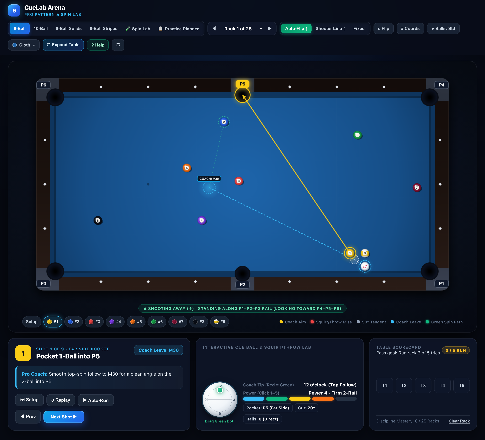
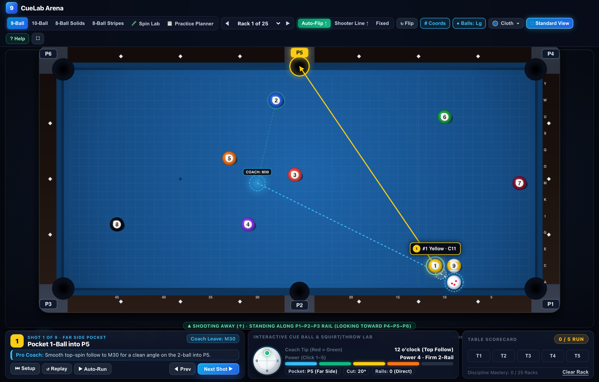
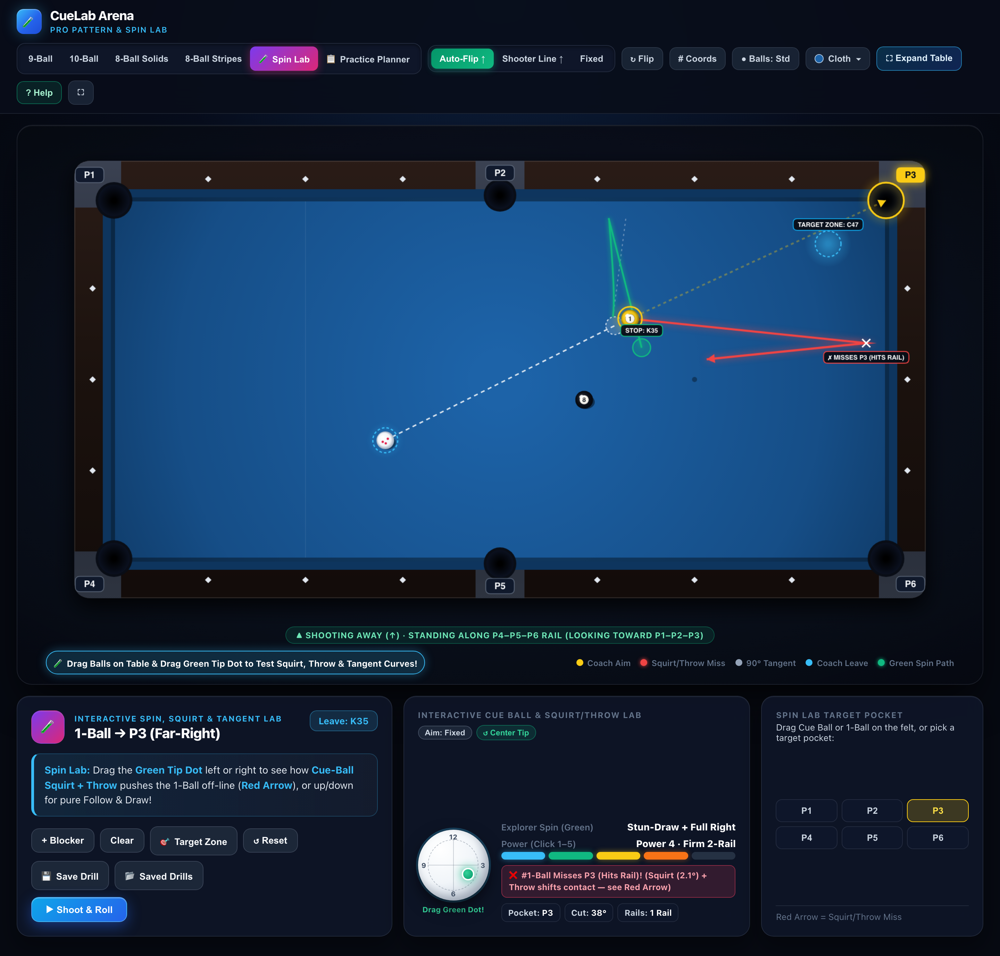
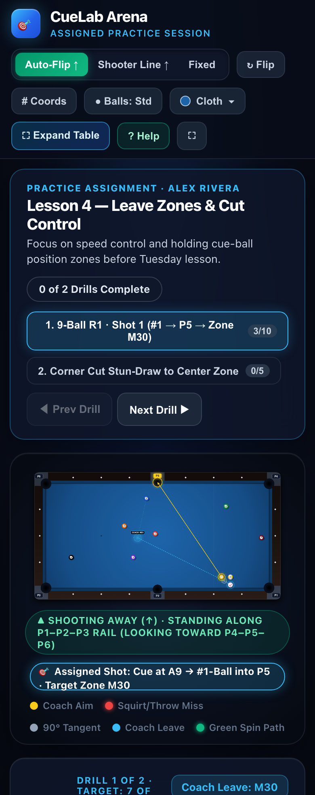
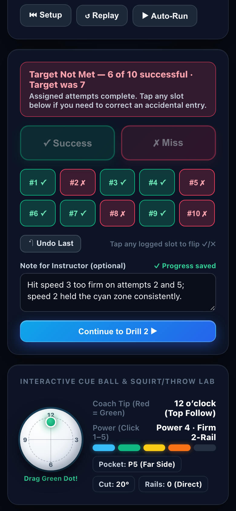
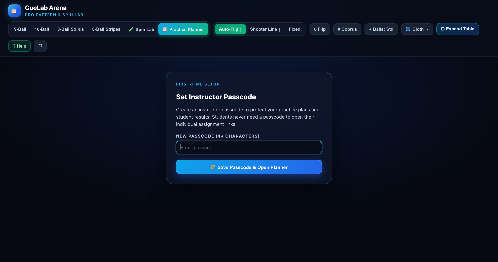
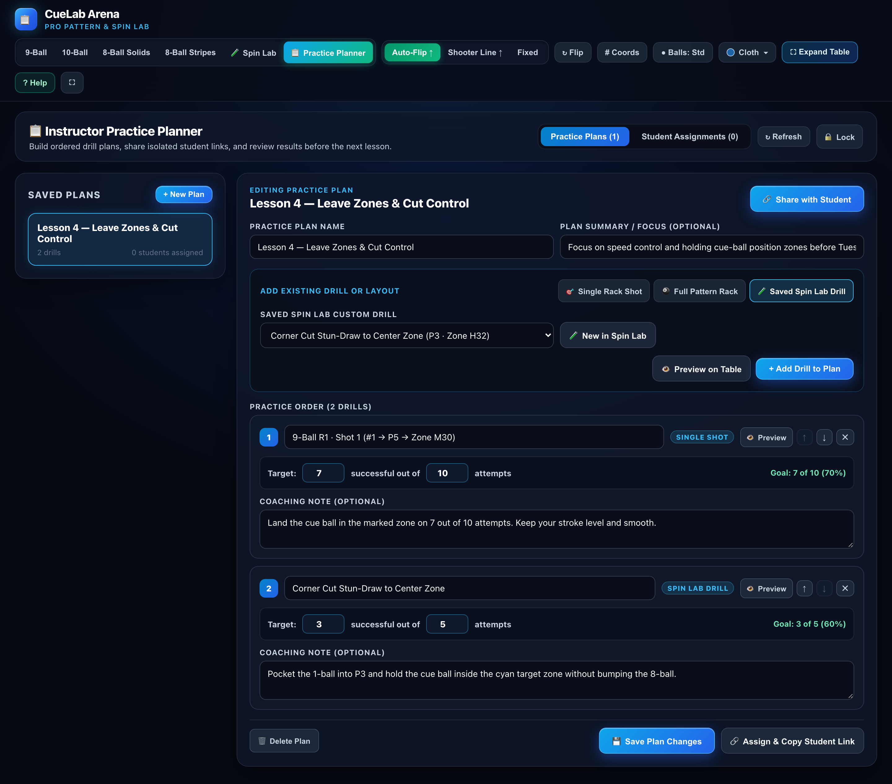
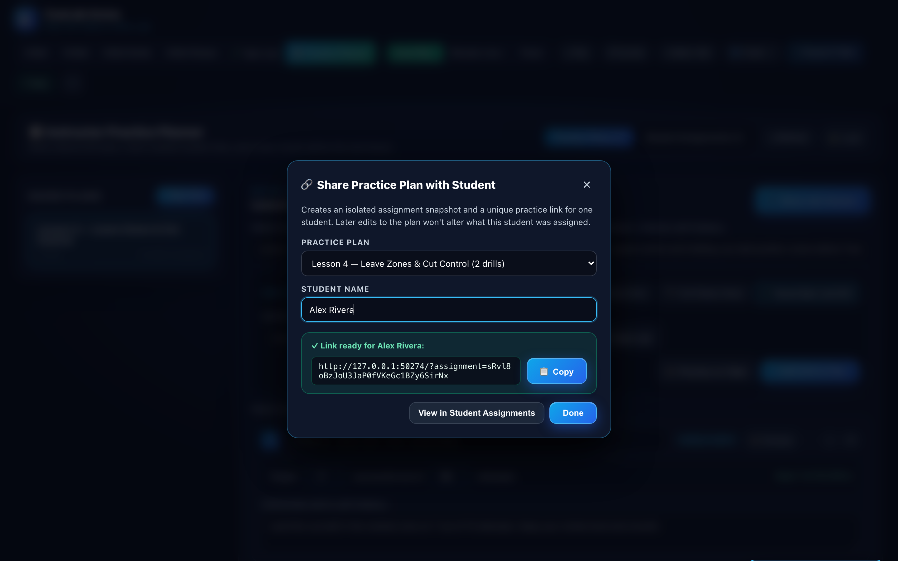
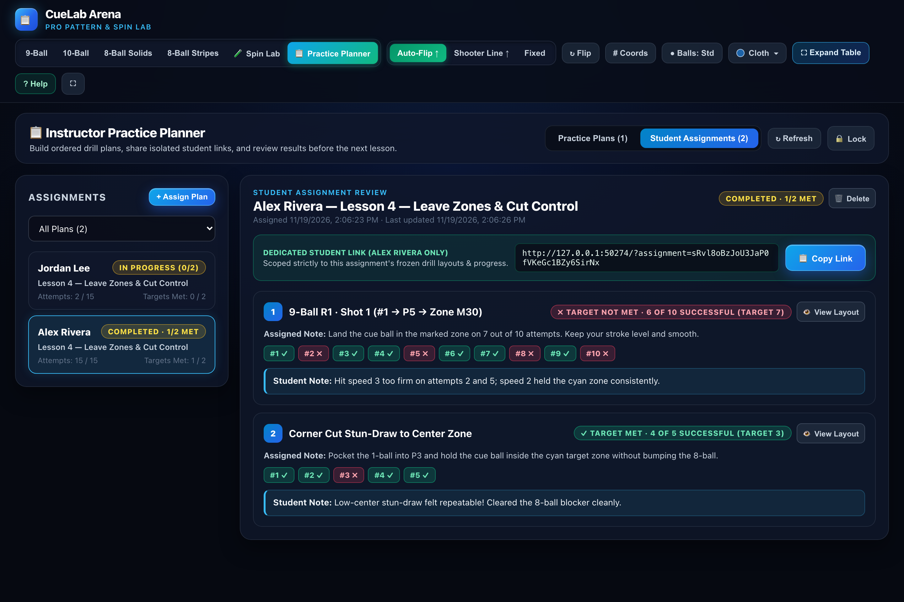

<!-- audience: all -->
# CueLab Arena — User Manual

Welcome to **CueLab Arena**, an interactive pool pattern trainer, spin & physics sandbox, and instructor-to-student practice planner for **8-Ball**, **9-Ball**, and **10-Ball**.

> **Quick Orientation:** This manual is divided into three sections so you can jump straight to what you need: **Players & Table Viewing**, **Student Practice Sessions** (opened from a shared link), and the **Instructor Practice Planner**.

---

<!-- audience: player -->
## 1. Pattern Rack Library (100 Physics-Verified Run-Outs)

CueLab Arena includes **75 unique rack layouts / 100 complete run-outs**: 25 racks each for **9-Ball**, **10-Ball**, **8-Ball Solids**, and **8-Ball Stripes**.

### Stepping Through a Rack
1. **Choose a Discipline** in the top navigation bar (`9-Ball`, `10-Ball`, `8-Ball Solids`, or `8-Ball Stripes`).
2. **Pick a Rack** using the `◀ Rack 1 of 25 ▶` dropdown selector.
3. **Set Up the Balls** on your physical pool table using the starting coordinates shown in **Setup** view (turn on `# Coords` or hover/tap any ball to read its exact grid spot).
4. **Step Through Each Shot** using **Start Run-Out ▶**, **Next Shot ▶**, **◀ Prev**, or by clicking any ball number pill (`#1`–`#9`) along the timeline bar below the table.
5. **Watch the Run-Out** with **↺ Replay** (re-animates the active shot) or **▶ Auto-Run** (plays the entire rack sequentially with automatic rotation pauses).

### Reading the Table Lines & Colors
| Visual Indicator | Meaning |
| :--- | :--- |
| **Yellow Arrow** | Official object-ball line into the highlighted target pocket (`P1`–`P6`). |
| **White Dashed Line & Ghost Ring** | Cue-ball aim line to the ghost-ball impact point. |
| **Cyan Dashed Path & Glow Zone** | Recommended cue-ball leave path and target position zone (`COACH: M30`). |
| **Silver Dashed Line** | Pure 90° tangent line from contact. |
| **Green Path & Circle** | Live "What-If" cue-ball path when you test custom spin or power. |
| **Red Arrow & X Marker** | Simulated **Squirt / Throw Miss** when side English pushes the object ball off pocket line. |

### Table Viewing Controls, Expanded Mode & Ball Magnifier
Designed for tablets, laptops, and phones positioned right next to your pool table:

- **Shooter-Perspective Rotation**:
  - **Auto-Flip ↑** (default): Flips the table 180° automatically whenever a shot faces downward so you always aim *away* from yourself.
  - **Shooter Line ↑**: Rotates continuously so the active cue-ball aim line points straight up (12 o'clock).
  - **Fixed**: Keeps the table locked in one orientation (use **↻ Flip** or press `F` to flip manually).
- **# Coords**: Toggles the `A–Z` / `1–50` coordinate grid across the cloth for spotting balls accurately.
- **● Balls: Std / Lg / XL**: Enlarges balls and numbers so you can read the layout from across the pool table.
- **Cloth ▾**: Switch between 12 tournament cloth colors (Tournament Blue, Simonis Green, Shark Grey, Burgundy, and more).
- **⛶ Expand Table**: Enlarges the pool table to fill your screen while compacting the bottom cards into a single-row dock.
- **Ball Magnifier**: Hover with a mouse or tap any ball on the table to pop up a high-contrast magnifier callout showing the ball number, color, and exact grid coordinate.

### Interactive Cue-Tip Explorer & Personal Scorecard
- **Drag the Green Dot** on the white cue-ball widget to explore Follow (12 o'clock), Draw (6 o'clock), and Left/Right English (9 / 3 o'clock).
- **Click Power Bars (1–5)** to compare Touch speed through Full Speed.
- **Aim: Fixed vs. Aim: Adjusted**: Toggle whether your aim stays fixed (demonstrating real deflection/squirt & spin-induced throw misses) or compensates for English.
- Click **↺ Snap to Coach** anytime to return to the recommended shot tip and speed.
- **Personal Table Scorecard**: Track up to 5 attempts (`T1`–`T5`) per rack locally on your device. Tap a slot to cycle **✓ Run → ✗ Miss → Blank**; running 2 of 5 marks the rack **PASSED** toward your 25-rack discipline mastery.

### Keyboard Shortcuts (Desktop)
| Key | Action |
| :--- | :--- |
| `→` / `←` | Next Shot / Previous Shot |
| `R` | Reset to Rack Setup |
| `F` | Flip Table 180° |
| `E` | Toggle Expanded Table Mode |
| `Esc` | Close Open Modal or Enlarged Screenshot |

---

<!-- audience: player -->
## 2. Spin Lab Sandbox & Custom Drills

Click **🧪 Spin Lab** in the top navigation bar to experiment freely with shot geometry, blockers, English deflection, and target leave zones.

### Experimenting in Spin Lab
1. **Drag Balls Directly on the Felt**: Move the **Cue Ball**, **1-Ball**, or any **Blocker Ball** anywhere on the cloth.
2. **Pick a Target Pocket**: Click any pocket (`P1`–`P6`) directly on the table or use the **Spin Lab Target Pocket** grid on the right.
3. **Add or Clear Blockers**: Use **+ Blocker** to add obstacle balls and **Clear** to remove them.
4. **Test Spin & Power**: Drag the green cue-tip dot and click Power 1–5 to inspect live 90° tangent lines, multi-rail rebounds, scratch warnings, and red squirt/throw misses.
5. **Mark a Target Zone**: Click **🎯 Target Zone** to place a glowing cyan leave zone on the cloth (it snaps automatically to your current shot's stop spot, and you can drag the zone anywhere on the felt).
6. **Animate the Shot**: Click **▶ Shoot & Roll** to watch the shot physics play out.

> **Tip for Instructors:** Once you craft a custom shot in Spin Lab, click **💾 Save Drill** to store it in your reusable Custom Drill Library (or **📂 Saved Drills** to load and edit an earlier layout) so you can assign it inside any Practice Plan.

---

<!-- audience: student -->
## 3. Student Practice Guide (Using a Shared Assignment Link)

When your instructor assigns practice, they will send you a dedicated link that opens directly into **Student Practice Mode** — no account or password required.

> **Private & Focused:** Your practice link opens only your assigned drills and progress. You can safely bookmark it, close the tab, and come back later on your phone or tablet with all attempts and notes intact.

### Working Through Your Assigned Drills
1. **Review Your Practice Order**: At the top of the screen, you will see your plan name, overall progress (`0 of 2 Drills Complete`), and numbered drill tabs (`1`, `2`, ...) in the exact order your instructor assigned.
2. **Read the Diagram & Coaching Note**:
   - View the table layout, ball positions, target pocket, and cyan leave zone.
   - Use **Auto-Flip ↑**, **# Coords**, **● Balls**, or **Cloth** in the top bar if you want larger balls or grid lines while setting up your table.
   - Tap any ball on the table to see its exact coordinate in the floating magnifier.
   - Tap **↺ Replay** (or **▶ Shoot & Roll**) to watch the recommended shot motion.
   - Read your instructor's **Coaching Note** and **Target** (for example, *7 of 10 successful*).
3. **Log Each Attempt at the Pool Table**:
   - After shooting each attempt, tap the large green **✓ Success** button if you achieved the drill goal, or the red **✗ Miss** button if you missed.
   - Progress saves automatically after every tap (`✓ Progress saved`).

### Correcting Accidental Entries & Leaving Notes

- **Undo the Last Tap**: Tap **↶ Undo Last** to immediately remove your most recent entry.
- **Fix an Earlier Entry**: Tap any recorded slot (`#1`–`#10`) directly to flip it between **✓** and **✗** without losing your later attempts.
- **Target Completion Summary**: Once you record all assigned attempts for a drill, the banner updates automatically to show whether you met the target — for example, **Target Not Met — 6 of 10 successful · Target was 7** or **✓ Target Met — 4 of 5 successful · Target was 3**.
- **Leave an Optional Note**: Type a quick note for your instructor in **Note for Instructor (optional)** (such as speed feel, tip height, or what caused misses). Your note saves automatically as you type.
- **Move to the Next Drill**: Tap **Continue to Drill 2 ▶** (or any numbered drill pill at the top) to keep going.

---

<!-- audience: instructor -->
## 4. Instructor Practice Planner Guide

Click **📋 Practice Planner** in the top navigation bar to create reusable drill plans, generate unique links for each student, and review student results before your next lesson.

### First-Time Passcode Setup
The first time you open **📋 Practice Planner**, create an **Instructor Passcode** (4 or more characters). This protects your practice plans and all student results while keeping individual student share links one-tap accessible without any login.

- Use **🔒 Lock** in the top-right corner of the Planner anytime to sign out on a shared computer.

### Creating & Ordering a Practice Plan
1. In the **Practice Plans** tab, click **+ New Plan** and enter a **Practice Plan Name** (plus an optional **Plan Summary / Focus**).
2. Under **Add Existing Drill or Layout**, choose from any of three drill sources:
   - **🎯 Single Rack Shot**: Pick any discipline, rack (`1–25`), and specific shot (including its marked cue-ball leave zone).
   - **🎱 Full Pattern Rack**: Assign an entire run-out rack.
   - **🧪 Saved Spin Lab Drill**: Pick any custom layout you saved from Spin Lab (with its blockers and optional cyan Target Zone).
3. Click **👁 Preview on Table** to inspect a drill on the full arena canvas before adding it, then click **+ Add Drill to Plan**.
4. For each drill in **Practice Order**:
   - Use **↑** and **↓** to set the exact practice sequence, or **✕** to remove a drill.
   - Customize the **Drill Title** if desired.
   - Set the **Target**: number of **successful** attempts out of total **attempts** (for example, `7` successful out of `10` attempts).
   - Add an optional **Coaching Note** describing what counts as a success and key cues to focus on.
5. Click **💾 Save Practice Plan**.

### Sharing a Plan with Individual Students
1. Click **🔗 Share with Student** (or **+ Assign Plan** in the Student Assignments tab).
2. Choose the Practice Plan, enter the **Student Name**, and click **Create Student Link**.
3. Click **📋 Copy** and send that unique link to the student via text, email, or messaging app.

> **Immutable Snapshots & Separate Student Results:** Every time you assign a plan to a student, CueLab Arena freezes an independent snapshot of all drill layouts, targets, and coaching notes for that student. Assigning the same plan to five students gives each student their own private link and results — and editing the plan or a saved Spin Lab drill later will **never** alter what an earlier student was asked to practice.

### Reviewing Student Results Before the Next Lesson
1. Switch to the **Student Assignments** tab and click **↻ Refresh** to pull the latest logged attempts and notes.
2. Filter by Practice Plan if needed, then click a student's name on the left to inspect their session:
   - **Overall Status Badge**: `Not Started`, `In Progress`, or `Completed` with total targets met.
   - **Per-Drill Outcome**: Exact successes out of attempts and whether the target was met (`✓ Target Met` vs. `✗ Target Not Met`).
   - **Attempt-by-Attempt Strip**: Visual `#1 ✓` / `#2 ✗` sequence so you can spot patterns (like warming up late or tiring out).
   - **Student Notes**: Displayed directly below each drill's attempt strip.
   - **👁 View Layout**: Click to inspect the exact frozen table diagram that student practiced, then click **← Back to Practice Planner** to return.

---

<!-- audience: all -->
## 5. Troubleshooting & Tips

- **Practice Planner or Full Help Manual won't load?** Make sure you started the local server (`cd app && npm start`) and opened **`http://127.0.0.1:3000`** instead of opening `index.html` directly via `file://`.
- **Testing a Student Link on your phone on the same Wi-Fi?** Start the server with `HOST=0.0.0.0 npm start` and replace `127.0.0.1` in the share link with your computer's local Wi-Fi IP address (e.g., `http://192.168.1.25:3000/?assignment=...`).
- **Accidentally tapped the wrong attempt on a phone?** Tap **↶ Undo Last** to remove the final entry, or tap any numbered slot (`#1`–`#10`) to toggle it between **✓** and **✗** — even after all attempts are logged.
- **Table looks small from across the pool room?** Tap **⛶ Expand Table**, switch **● Balls** to `Lg` or `XL`, and tap any ball to inspect its coordinates with the floating magnifier.
- **Keyboard shortcuts firing while typing?** Shortcuts (`R`, `F`, `E`, Arrow keys) are automatically paused whenever your cursor is inside a text input or note field.
